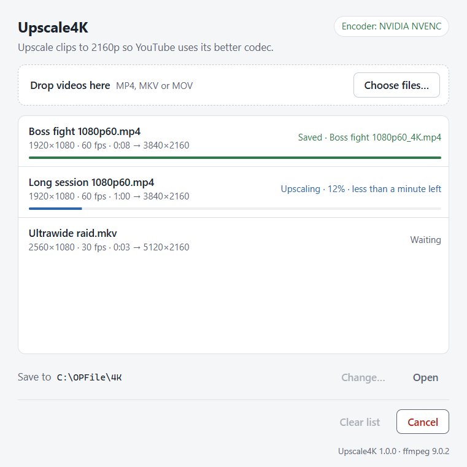

# Upscale4K

Upscale gameplay clips to 4K (2160p) before uploading them to YouTube.

YouTube gives 4K uploads its higher quality codec (VP9 or AV1) and a much higher bitrate, even when you watch them at 1080p or 1440p. Upscaling a 1080p or 1440p clip to 2160p before upload is a simple way to get noticeably cleaner gameplay videos on YouTube. Upscale4K does that with ffmpeg in a small desktop app for Windows and macOS.



## What it does

- Add one or more videos (MP4, MKV, MOV) with the file picker or by dragging them onto the window.
- Upscales to a height of 2160 pixels and keeps the aspect ratio (`scale=-2:2160:flags=lanczos`).
- Keeps the original frame rate and copies the audio.
- Uses the GPU when it can: NVIDIA NVENC on Windows, Apple VideoToolbox on macOS. Otherwise it uses libx264 on the CPU.
- Saves `<original name>_4K.mp4` in an output folder you choose. The folder is remembered.
- Never overwrites a file silently. If the 4K file already exists, it asks whether to keep both (a number is added), replace, or skip.
- Shows progress for each file, has a Cancel button, and opens the output folder when it is done.

## Requirements

- Windows 10 or 11 (64-bit), or macOS 11 Big Sur or later (Apple Silicon or Intel).
- ffmpeg, installed separately. Upscale4K does not include it.
  - Windows: `winget install --id Gyan.FFmpeg -e`
  - macOS: `brew install ffmpeg` (install [Homebrew](https://brew.sh) first if you don't have it)

If ffmpeg is missing, the app shows the command. On Windows it also has a button that runs it for you.

## Install

Download Upscale4K from the [Releases page](../../releases). The current release is a beta.

### Windows

1. Download `Upscale4K_<version>_x64-setup.exe` and run it. It installs for your user account and doesn't need administrator rights.
2. The installer isn't code-signed, so Windows SmartScreen may show "Windows protected your PC". Choose **More info**, then **Run anyway**.
3. Start Upscale4K from the Start menu.

### macOS

1. Download the disk image for your Mac:
   - Apple Silicon (M1 and later): `Upscale4K_<version>_aarch64.dmg`
   - Intel: `Upscale4K_<version>_x64.dmg`
2. Open the disk image and drag **Upscale4K** to **Applications**.

#### First launch on macOS

The app is signed ad hoc but not notarized by Apple, so macOS blocks it the first time:

1. Open Upscale4K from Applications. macOS says it can't verify the app. Choose **Done** (or **OK**).
2. Open **System Settings** > **Privacy & Security**.
3. Scroll down to the Security section. Next to the message about Upscale4K, choose **Open Anyway**.
4. Confirm with your password or Touch ID, then choose **Open Anyway** again.

You only need to do this once. If you prefer Terminal, this does the same:

```bash
xattr -dr com.apple.quarantine /Applications/Upscale4K.app
```

## Use

1. Drop videos onto the window, or choose **Choose files…**.
2. Check the output folder next to **Save to**. Choose **Change…** to pick another one.
3. Choose **Upscale**. Each file shows its progress and the time left.
4. When the batch is done, the output folder opens.

The encoder in use is shown at the top right. Clips wider than 4096 pixels after upscaling (for example 21:9 ultrawide recordings) use libx264, because the hardware encoders can't make H.264 that wide. If a hardware encode fails, the clip is encoded again with libx264.

### Default output folder

- Windows: `C:\OPFile\4K`
- macOS: `~/Movies/Upscale4K`

On a Windows PC shared with other accounts, choose an output folder inside your own user folder (for example `Videos`), since other accounts may be able to create or read folders at the root of the drive.

## How it works

For each clip Upscale4K runs ffmpeg like this (NVENC example):

```text
ffmpeg -protocol_whitelist file -format_whitelist mov,matroska -i <input>
       -map 0:V:0 -map 0:a? -vf scale=-2:2160:flags=lanczos
       -c:v h264_nvenc -preset p7 -rc vbr -cq 19 -b:v 0 -pix_fmt yuv420p
       -c:a copy -movflags +faststart -f mp4 <output>.part
```

The input is only opened as a local MP4/MOV or Matroska file, so a file that is something else under a video name (a playlist, for example) is refused instead of being followed.

| Encoder | Used on | Video settings |
| --- | --- | --- |
| `h264_nvenc` | Windows with an NVIDIA GPU | `-preset p7 -rc vbr -cq 19 -b:v 0` |
| `h264_videotoolbox` | macOS | 45 Mbit/s up to 30 fps, 68 Mbit/s above (YouTube's 2160p guidance) |
| `libx264` | everywhere, as the fallback | `-preset medium -crf 19` |

The encoder is checked at startup with a tiny test encode. The video is written to a temporary `.part` file and renamed when the encode succeeds, so a cancelled or failed encode never leaves a half-written video. Audio is copied as it is. Audio that MP4 can't hold well (for example PCM from some MOV files) is converted to AAC at 384 kbit/s.

## Troubleshooting

**"ffmpeg not found"** — Install ffmpeg with the command shown in the app, then choose **Check again**. You don't need to restart the app. On macOS, ffmpeg from Homebrew (`/opt/homebrew/bin` or `/usr/local/bin`) and MacPorts (`/opt/local/bin`) is found automatically.

**"Can't write to the output folder"** — Choose another folder, or check its permissions. On Windows, **Controlled Folder Access** (ransomware protection) can block apps from writing to protected folders such as Documents, Pictures and Videos. To allow Upscale4K, open **Windows Security** > **Virus & threat protection** > **Ransomware protection** > **Allow an app through Controlled folder access**, and add both `Upscale4K.exe` and `ffmpeg.exe` (the app shows the exact ffmpeg path).

**Encoding is slow** — The encoder at the top right shows what is used. libx264 (CPU) is much slower than NVENC or VideoToolbox.

## Build from source

Requirements: [Rust](https://rustup.rs) 1.90 or newer, [Node.js](https://nodejs.org) LTS, and the [Tauri prerequisites](https://v2.tauri.app/start/prerequisites/) for your system (on Windows: the MSVC build tools and WebView2).

```bash
npm ci
npm run tauri dev
```

Build the installer:

```bash
npm run tauri build
```

Run the tests (the infrastructure tests need ffmpeg and ffprobe on the machine):

```bash
cargo test -p upscale4k-domain -p upscale4k-application
cargo test -p upscale4k-infrastructure
```

### Project layout

The Rust code follows a light clean architecture. Each layer is its own crate, so inner layers can't depend on outer ones.

| Folder | Layer | Contents |
| --- | --- | --- |
| `crates/domain` | Domain | Accepted files, output names and the no-overwrite rule, ffmpeg arguments per encoder, progress math |
| `crates/application` | Application | Batch upscale, output folder setting, startup checks, and the ports (traits) they need |
| `crates/infrastructure` | Infrastructure | ffmpeg and ffprobe processes, progress parsing, files, settings, Windows and macOS specifics |
| `src-tauri` | UI (backend) | Tauri commands and app setup |
| `src` | UI (frontend) | HTML, CSS and TypeScript, no framework |

### Dependency updates

[Dependabot](https://docs.github.com/en/code-security/dependabot) is GitHub's own update service. Once a month it checks the GitHub Actions, Rust crates and npm packages the project uses, and opens a pull request when a newer version is out. The tests run on every such pull request before it is merged. This is why `dependabot[bot]` is listed among the contributors. The schedule is in [`.github/dependabot.yml`](.github/dependabot.yml).

## License

[MIT](LICENSE)
